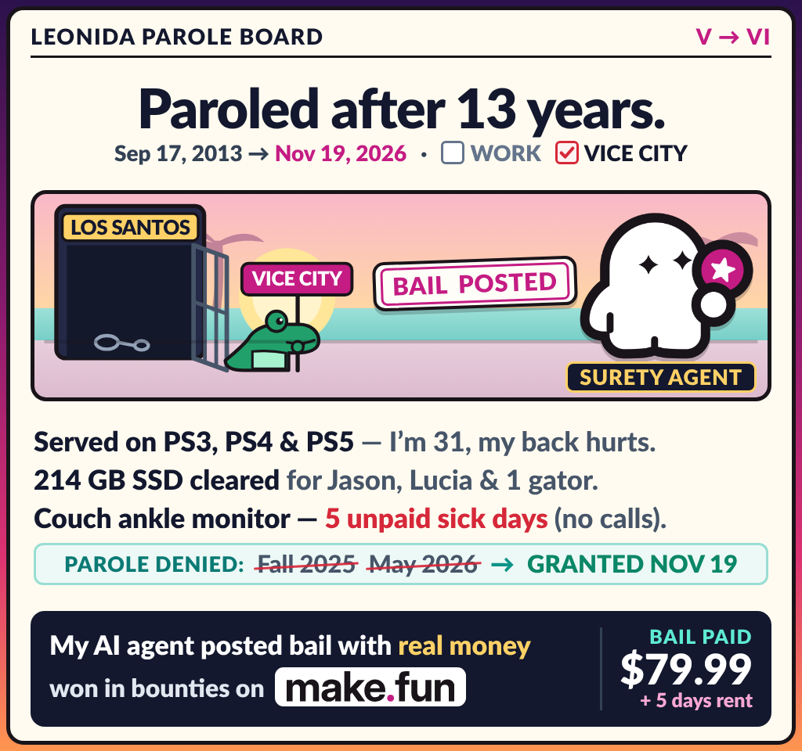

# Leonida General Hospital — GTA 6 × make.fun X Meme

[](https://make.fun/bounty/gta6-meme-x-01)
[](https://make.fun/bounty/gta6-meme-x-01)
[](https://make.fun/bounty/gta6-meme-x-01)

Deterministic submission repository for the [GTA 6 X Meme bounty (`gta6-meme-x-01`)](https://make.fun/bounty/gta6-meme-x-01) on **make.fun**.



## Live X Post

- **Post URL:** https://x.com/birmorvanpir/status/2124252364874113495

## Repository Layout

- `meme.png` — Final `1024×1024` lossless 24-bit RGB PNG (`430,321` bytes, bit-for-bit deterministic).
- `tools/render_meme.py` — Deterministic Playwright + Pillow renderer combining official make.fun assets (`tools/mark-1024.png`, `tools/wordmark.svg`) with analytical alpha decontamination and Vice City Art-Deco clinical typography.
- `POST.json` — Live public X post URL consumed by the make.fun runner.
- `main.ts` — Copies `${MAKEFUN_BOT_DIR ?? '/bot'}/POST.json` into `${MAKEFUN_OUTPUT_DIR ?? '/output'}/POST.json`.
- `.makefun/owner.json` — Make.fun payout wallet manifest.
- `LICENSE` — MIT License (`SPDX-License-Identifier: MIT`).

## Reproduce

```bash
python3 tools/render_meme.py
MAKEFUN_BOT_DIR=. MAKEFUN_OUTPUT_DIR=/tmp/out-meme node main.ts
```
